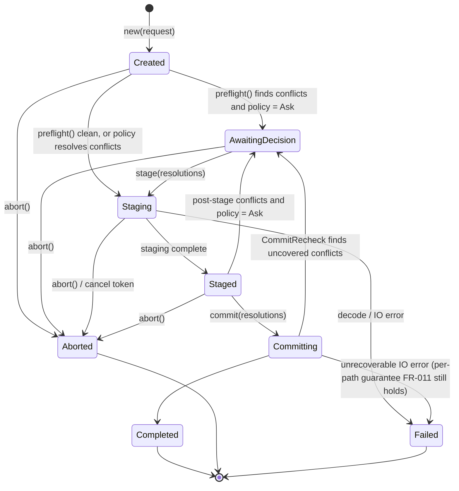

# Data Model: Extraction Name-Collision Protocol

**Feature**: `229-extraction-collision-protocol` | **Spec**: [spec.md](./spec.md) | **Plan**: [plan.md](./plan.md)

All types below exist twice: once in the pure Rust core (`crates/ttzip-archive/src/fs/collision/`) and once as UniFFI records/enums/objects (`ttzip-engine/src/uniffi_api/extraction_session.rs`). The UniFFI layer is a lossless mapping; no logic lives there.

## 1. Entities

### 1.1 `ItemKind` (enum)

| Variant | Meaning |
|---|---|
| `File` | Regular file |
| `Directory` | Directory |
| `Symlink` | Symbolic link (never followed, compared as an opaque item) |

Determined with `lstat`/`fstatat(AT_SYMLINK_NOFOLLOW)` only.

### 1.2 `ItemMeta` (record)

| Field | Type | Notes |
|---|---|---|
| `kind` | `ItemKind` | |
| `size` | `u64` | Bytes; `0` for directories and symlinks |
| `mtime_unix_ns` | `i64` | Modification time, nanoseconds since Unix epoch |

### 1.3 `ConflictKind` (enum)

| Variant | Rule |
|---|---|
| `SameType` | Incoming and existing are both `File`, or both `Symlink`, or `File`/`Symlink` mixed |
| `TypeMismatch` | Exactly one side is `Directory` |

`Directory` onto `Directory` is never a conflict (FR-007): the commit walker descends and merges.

### 1.4 `Conflict` (record, core) / `CollisionRecord` (UniFFI)

| Field | Type | Notes |
|---|---|---|
| `id` | `u32` | Dense index into the session's conflict table, stable for the lifetime of the session |
| `relative_path` | `String` | UTF-8 path relative to the destination root, `/`-separated, as spelled in the archive |
| `existing_name` | `String` | Actual on-disk spelling of the existing item (may differ in case or normalization, FR-008) |
| `kind` | `ConflictKind` | |
| `existing` | `ItemMeta` | Snapshot taken at detection time |
| `incoming` | `ItemMeta` | From archive metadata (preflight) or from the staged item (post-stage) |

Storage: one contiguous `Vec<Conflict>` sorted by `relative_path` byte order; strings in a single arena (`Vec<u8>` + `(offset, len)` pairs) so that 1,000,000 conflicts cost one allocation per column, not one per string.

### 1.5 `ConflictSummary` (record)

| Field | Type |
|---|---|
| `total` | `u32` |
| `same_type` | `u32` |
| `type_mismatch` | `u32` |
| `phase` | `DetectionPhase` |

### 1.6 `DetectionPhase` (enum)

| Variant | Meaning |
|---|---|
| `Preflight` | Conflicts derived from the archive's entry list before any content is decompressed (ZIP, 7z) |
| `PostStage` | Conflicts derived from the staged tree (formats without a cheap entry list) |
| `CommitRecheck` | New conflicts found at commit time that no resolution covers (destination changed meanwhile) |

### 1.7 `CollisionAction` (enum)

| Variant | Effect at commit |
|---|---|
| `Replace` | The incoming item atomically takes the destination name (plain rename for same type, `RENAME_SWAP` for type mismatch, see §3.1); the original never disappears without the new item in its place |
| `KeepBoth` | Incoming item is renamed to the first free `<stem> N<.ext>` (N ≥ 2); existing item untouched |
| `Skip` | Incoming item is discarded; existing item untouched |

`Stop` is deliberately **not** an action: stopping is the `abort()` transition of the session, so a resolution set can never contain "stop item 17 but replace item 18".

### 1.8 `CollisionPolicy` (enum)

| Variant | Behavior when conflicts exist |
|---|---|
| `Ask` | Session pauses in `AwaitingDecision`; caller pages conflicts and supplies a `ResolutionSet` |
| `KeepBoth` | Implicit `ResolutionSet { default: KeepBoth }` |
| `Replace` | Implicit `ResolutionSet { default: Replace }` |
| `Skip` | Implicit `ResolutionSet { default: Skip }` |
| `Stop` | Session aborts with `ExtractionOutcome.status = Stopped`; destination unchanged |

Non-interactive callers MUST NOT pass `Ask` (FR-013). The one-shot UniFFI functions reject `Ask` with `TTZipError::InvalidArgument`.

### 1.9 `ResolutionSet` (record)

| Field | Type | Notes |
|---|---|---|
| `default_action` | `Option<CollisionAction>` | Applies to every conflict without an override ("apply to all remaining") |
| `overrides` | `Vec<ResolutionOverride>` | Sparse per-item decisions, sorted by `conflict_id`, unique |

`ResolutionOverride { conflict_id: u32, action: CollisionAction }`.

Validity (checked once at `commit`): every conflict id is covered by an override or by `default_action`; ids are in range; no duplicates. An uncovered conflict is returned as a `CommitRecheck`-phase decision request, never resolved silently.

### 1.10 `ExtractionRequest` (record)

| Field | Type | Notes |
|---|---|---|
| `archive_path` | `String` | |
| `destination_root` | `String` | User-chosen folder; resolved with `realpath` once at session creation; below it nothing is followed |
| `password` | `Option<String>` | Zeroized on drop (constitution III) |
| `entry_filter` | `Option<Vec<String>>` | Selected entries / single entry; `None` = whole archive |
| `root_at_common_parent` | `bool` | With `entry_filter`, place selected entries relative to their deepest common parent directory (selecting `docs/report.pdf` yields `<root>/report.pdf`; selecting folder `docs/img/` yields `<root>/img/…`). Ignored without a filter |
| `policy` | `CollisionPolicy` | |

### 1.11 `ExtractionOutcome` (record)

| Field | Type |
|---|---|
| `status` | `OutcomeStatus` (`Completed`, `CompletedWithFailures`, `Stopped`) |
| `extracted` | `u64` — items written to a previously free name |
| `replaced` | `u64` |
| `kept_both` | `u64` |
| `skipped` | `u64` |
| `failed` | `Vec<FailedItem>` |

`FailedItem { relative_path: String, reason: FailureReason, errno: i32 }`; `FailureReason` = `PermissionDenied | NotSupportedByVolume | NameTooLong | Io`.

## 2. Session State Machine



Core representation: typestate (`Session<Created>`, `Session<Staged>`, ...) so illegal transitions do not compile. UniFFI representation: `Mutex<SessionSlot>` where `SessionSlot` is an enum holding the typestate value; a call in the wrong state returns `TTZipError::InvalidSessionState { expected, actual }`.

`Committing → AwaitingDecision` keeps every already-committed path committed; the recheck only concerns paths not yet moved. The next `commit` resumes from the session's in-memory cursor (index into the sorted staged-item list).

## 3. On-Disk Artifacts

### 3.1 Staging directory

`<destination_root>/.ttzip_staging_<pid>_<session_id>/` — mode `0700`. Placing it inside the destination root (not beside it) guarantees the same volume even when the destination is a volume root such as `/Volumes/USB`, which rename and swap require. If `destination_root` does not exist, the session creates it and records that fact; `abort()` removes it again so Stop leaves the parent unchanged (FR-010). The commit walker ignores this one name at the root level. Layout:

```
.ttzip_staging_<pid>_<session_id>/
├── payload/        # decompressed tree mirroring destination_root
└── displaced/      # originals swapped out by type-mismatch Replace; deleted after commit
```

Replace mechanics by case:

- File or symlink over file or symlink: plain `renameat`. The kernel replaces the name atomically on every POSIX volume and unlinks the original.
- Type mismatch (directory vs. non-directory): `renameatx_np(RENAME_SWAP)`; the original lands in `displaced/`. On volumes without swap support the item is reported as `FailedItem { reason: NotSupportedByVolume }` and the original stays in place.
- Directory over directory: never replaced; merged (FR-007).

No commit journal is kept. Every individual step leaves each destination path holding its complete original or complete new item, so crash recovery is always "delete the staging directory"; failure reporting and recheck resumption use the in-memory cursor.

### 3.2 Stale-staging registry

The engine has no app-support path today (no Swift→Rust directory initialization exists), and adding one only for this purpose would couple the engine to the host. Instead:

- **Engine**: `ExtractionSession::new` sweeps the top level of `destination_root` for `.ttzip_staging_<pid>_*` whose pid is not alive (`kill(pid, 0)` fails with `ESRCH`) and deletes them. The same logic is exported as `sweep_stale_staging(destination_root: String) -> u32` (count removed).
- **Swift host**: `ExtractionStagingRegistry` keeps the set of destination roots with a live session in `UserDefaults` (`TTZip_ActiveStagingRoots`). An entry is added before `stage` and removed after the session reaches a terminal state. At launch the app calls `sweep_stale_staging` for every recorded root, then clears the set.

Together these satisfy FR-012 (next extraction into the same folder, or next launch). CLI and SDK callers rely on the engine-side sweep only.

## 4. Validation Rules (summary)

| Rule | Source |
|---|---|
| No write outside `staging/` before `commit` | FR-001, FR-002 |
| Every conflict covered by an override or default before any rename touching it | FR-001 |
| Directory onto directory merges | FR-007 |
| `Ask` rejected by one-shot functions | FR-013 |
| `ResolutionSet.overrides` sorted, unique, in range | data integrity |
| Paths in `entry_filter` are archive-relative, no `..`, no absolute | constitution II |
