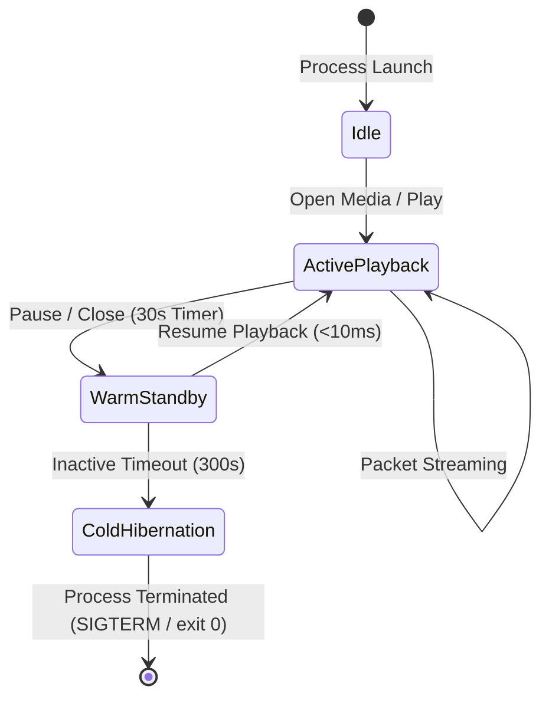
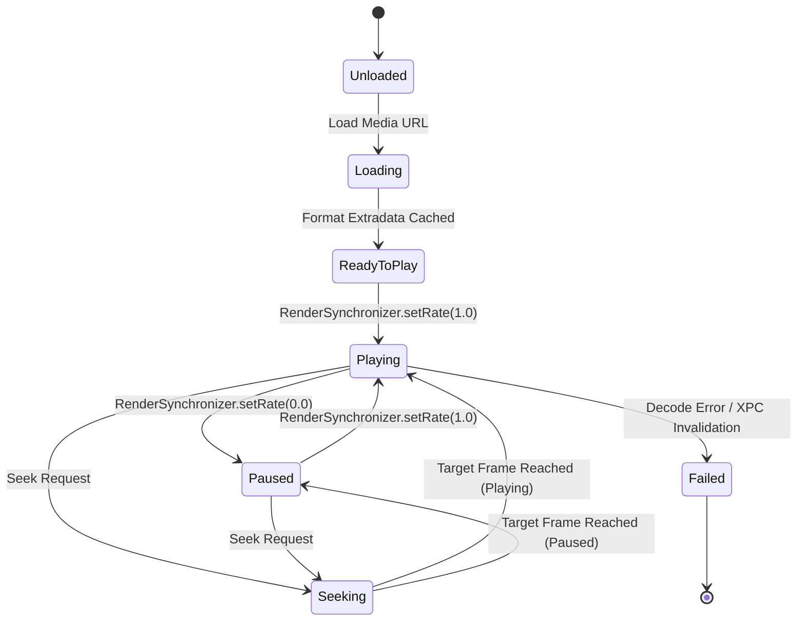

# Data Model: Unified AVSampleBuffer Media Pipeline (Feature 230)

**Feature**: `230-unified-avsamplebuffer-media-pipeline`

**Status**: Completed

---

## 1. Core Data Transfer Objects (DTOs)

### 1.1 MediaPacketDTO
Represents a single compressed or uncompressed audio/video packet transferred from `ttmedia-worker` to the host application via XPC.

```swift
public struct MediaPacketDTO: Sendable, Codable {
    public let streamIndex: UInt32
    public let mediaType: MediaType
    public let ptsValue: Int64
    public let ptsTimescale: Int32
    public let dtsValue: Int64
    public let dtsTimescale: Int32
    public let durationValue: Int64
    public let durationTimescale: Int32
    public let payloadData: Data
    public let isKeyframe: Bool
    public let doNotDisplay: Bool
    public let ioSurfaceId: UInt32? // Used only for zero-copy software-decoded frames
}
```

### 1.2 VideoFormatParameters
Immutable container for video decoder configuration parameters, parameter sets, and colorimetry.

```swift
public struct VideoFormatParameters: Sendable, Codable, Equatable {
    public let codec: VideoCodec
    public let width: Int32
    public let height: Int32
    public let pixelFormat: UInt32 // e.g. kCVPixelFormatType_420YpCbCr8BiPlanarVideoRange
    public let colorPrimaries: String?
    public let transferFunction: String?
    public let yCbCrMatrix: String?
    public let extradata: Data // SPS, PPS, VPS or codec-specific headers
}
```

### 1.3 AudioFormatParameters
Immutable container for audio decoder configuration parameters and layout.

```swift
public struct AudioFormatParameters: Sendable, Codable, Equatable {
    public let codec: AudioCodec
    public let sampleRate: Double
    public let channelCount: UInt32
    public let bitsPerChannel: UInt32
    public let channelLayoutTag: UInt32
    public let extradata: Data // AudioSpecificConfig, magic cookies
}
```

---

## 2. Enums and Discriminators

### 2.1 Codec Classifications
Explicit type enumeration preventing illegal combinations at compile-time:

```swift
public enum MediaType: UInt8, Sendable, Codable {
    case video = 1
    case audio = 2
    case subtitle = 3
}

public enum VideoCodec: String, Sendable, Codable {
    case h264 = "h264"
    case hevc = "hevc"
    case prores = "prores"
    case av1 = "av1"
    case vp9 = "vp9"
}

public enum AudioCodec: String, Sendable, Codable {
    case aac = "aac"
    case alac = "alac"
    case flac = "flac"
    case opus = "opus"
    case vorbis = "vorbis"
    case pcm = "pcm"
}
```

### 2.2 Worker Lifecycle State Machine
Governs the Two-Tier Sleep lifecycle:



| State | Memory Target | Transition Trigger | Actions |
| --- | --- | --- | --- |
| **ActivePlayback** | $\le 120\text{ MB}$ | User begins media playback | Demuxer thread running, reading packets |
| **WarmStandby** | $\le 25\text{ MB}$ | Playback stopped / paused > 30s | Free active decoder contexts; close file descriptors; retain XPC channel |
| **ColdHibernation** | $0\text{ MB}$ | Idle in WarmStandby > 300s | Exit process cleanly; release all Mach ports and memory |

---

## 3. Host State Machine (AVSampleBuffer Presentation)



---

## 4. Invariants & Bounds

1. **Packet Payload Bounded Allocation**: Packet payloads delivered over XPC MUST NOT exceed 16 MB per packet. Oversized packets trigger stream error and drop.
2. **Deterministic Timebase Monotonicity**: Timebase values strictly follow monotonic clock progressions. Reverse time flows during playback without seek command are rejected.
3. **Annex-B Immunity**: All H.264/HEVC payloads stored in `MediaPacketDTO` MUST be AVCC length-prefixed; zero `00 00 00 01` raw start codes are permitted in XPC transit.
