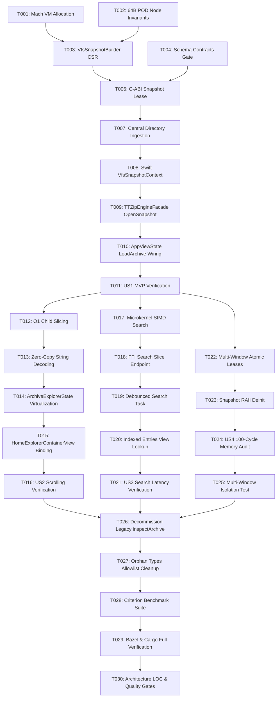

# Tasks: CSR Zero-Copy VFS & Million-Item Low-Memory Navigation (Feature 231)

**Feature Directory**: `products/ttzip/core/specs/231-csr-zero-copy-vfs`  
**Classification**: `[Full SDD]`  
**Status**: Ready for Implementation  

---

## Task Dependency Topology

---

## Phase 1: Setup & Foundational Memory Infrastructure

- [x] T001 Verify and test 16KB page-aligned `MachVmAllocation` and `mach_make_memory_entry_64` in [products/ttzip/core/rust/crates/ttzip-types/src/mach_vm.rs](file://rust/crates/ttzip-types/src/mach_vm.rs).
- [x] T002 [P] Verify 64-byte size, 64-byte alignment, and compile-time size assertions for `TTWorkspaceEntryNode` in [products/ttzip/core/rust/crates/ttzip-types/src/node.rs](file://rust/crates/ttzip-types/src/node.rs).
- [x] T003 [P] Verify `VfsSnapshotBuilder::build` outputs CSR flat node array and `StringArena` in [products/ttzip/core/rust/crates/ttzip-types/src/builder.rs](file://rust/crates/ttzip-types/src/builder.rs).
- [x] T004 Validate JSON schema contracts in `products/ttzip/core/specs/231-csr-zero-copy-vfs/contracts/` via `lint-contracts.sh`.
- [x] T005 Construct synthetic million-node test harness in [products/ttzip/core/rust/ttzip-engine/tests/test_1m_node_tree.rs](file://rust/ttzip-engine/tests/test_1m_node_tree.rs).

---

## Phase 2: User Story 1 - Instant Load of Million-Item Archives (Priority: P1) 🎯 MVP

**Goal**: Load an archive with 1,000,000 entries into memory within 300 ms with $\le 200\text{ MB}$ total VFS RSS memory.

- [x] T006 [US1] Implement C-ABI export `ttzip_vfs_open_snapshot(archive_path, password)` returning `*mut TTVfsLease` and `TTWorkspaceVfsView` in [products/ttzip/core/rust/ttzip-engine/src/ffi/vfs_ffi.rs](file://rust/ttzip-engine/src/ffi/vfs_ffi.rs).
- [x] T007 [US1] Wire central directory reader to directly populate `UnifiedVfsTable` without allocating intermediate `UniFfiEntryMetadata` in [products/ttzip/core/rust/crates/ttzip-archive/src/archive/unified/inspect.rs](file://rust/crates/ttzip-archive/src/archive/unified/inspect.rs).
- [x] T008 [US1] Ensure `VfsSnapshotContext` safely acquires and retains `TTWorkspaceVfsView` via RAII in [products/ttzip/apple/Sources/TTZipApp/Views/VfsSnapshotContext.swift](file://../apple/Sources/TTZipApp/Views/VfsSnapshotContext.swift).
- [x] T009 [US1] Implement `TTZipEngineFacade.openVfsSnapshot(path:password:) async throws -> VfsSnapshotContext` in [products/ttzip/core/Sources/TTZipCore/Facades/TTZipEngineFacade.swift](file://Sources/TTZipCore/Facades/TTZipEngineFacade.swift).
- [x] T010 [US1] Rewire `AppViewState.loadArchive(path:password:)` to call `openVfsSnapshot` and assign `snapshotContext` to `explorerState` in [products/ttzip/apple/Sources/TTZipApp/ViewModels/AppViewState+ArchiveOperations.swift](file://../apple/Sources/TTZipApp/ViewModels/AppViewState+ArchiveOperations.swift).
- [x] T011 [US1] Integration test verifying 1,000,000 synthetic entries load to first frame in $\le 300\text{ ms}$ with RSS delta $\le 150\text{ MB}$.

---

## Phase 3: User Story 2 - Sub-Millisecond Hierarchical Paging & Virtual Scrolling (Priority: P1)

**Goal**: Navigate folders containing 50,000+ items with sub-millisecond retrieval ($\le 1\text{ ms}$) and 120 FPS stutter-free scrolling.

- [x] T012 [US2] Implement $O(1)$ random-access slice retrieval `VfsSnapshotReader.readChildrenSlice(of:in:offset:limit:)` in [products/ttzip/apple/Sources/TTZipApp/Views/VfsSnapshotReader.swift](file://../apple/Sources/TTZipApp/Views/VfsSnapshotReader.swift).
- [x] T013 [P] [US2] Optimize string decoding from `StringArena` using zero-copy UTF-8 buffer slicing (`String(decoding:as:)`) in [products/ttzip/apple/Sources/TTZipApp/Views/VfsSnapshotReader.swift](file://../apple/Sources/TTZipApp/Views/VfsSnapshotReader.swift).
- [x] T014 [US2] Update `ArchiveExplorerState` to bind table rows directly to `VfsSnapshotReader` slices in [products/ttzip/apple/Sources/TTZipApp/ViewModels/AppSubStates.swift](file://../apple/Sources/TTZipApp/ViewModels/AppSubStates.swift).
- [x] T015 [US2] Update [products/ttzip/apple/Sources/TTZipApp/Views/Explorer/HomeExplorerContainerView.swift](file://../apple/Sources/TTZipApp/Views/Explorer/HomeExplorerContainerView.swift) to drive the file table from the active snapshot context.
- [x] T016 [US2] Automated performance test asserting 50-item child slice retrieval from a 50,000-item directory takes $\le 1\text{ ms}$ and allocations stay $\le 2\text{ MB/s}$.

---

## Phase 4: User Story 3 - High-Throughput Keystroke Search & Filtered Slice Indexing (Priority: P1)

**Goal**: Deliver sub-8.33 ms keystroke search response across 1,000,000 entries (120 Hz ProMotion compatible).

- [x] T017 [US3] Implement SIMD vectorized in-place substring and `sort_prefix` search `vfs_search_simd` in [products/ttzip/core/rust/crates/ttzip-types/src/search.rs](file://rust/crates/ttzip-types/src/search.rs).
- [x] T018 [US3] Expose C-ABI search endpoint `ttzip_vfs_search(lease, query, max_results, out_indices)` in [products/ttzip/core/rust/ttzip-engine/src/ffi/vfs_ffi.rs](file://rust/ttzip-engine/src/ffi/vfs_ffi.rs).
- [x] T019 [US3] Connect `ArchiveExplorerState.searchQuery` to debounced background search task with cooperative Task cancellation in [products/ttzip/apple/Sources/TTZipApp/ViewModels/AppSubStates.swift](file://../apple/Sources/TTZipApp/ViewModels/AppSubStates.swift).
- [x] T020 [US3] Implement `VfsSnapshotReader.readIndexedEntries(indices:in:offset:limit:)` in [products/ttzip/apple/Sources/TTZipApp/Views/VfsSnapshotReader.swift](file://../apple/Sources/TTZipApp/Views/VfsSnapshotReader.swift).
- [x] T021 [US3] Performance test asserting keystroke search across 1,000,000 items executes in $\le 8.33\text{ ms}$.

---

## Phase 5: User Story 4 - Multi-Window Independent VFS Leases & Safe Snapshot Lifecycle (Priority: P2)

**Goal**: Support multiple open windows with independent immutable leases and zero-leak memory reclamation on close.

- [x] T022 [US4] Implement atomic reference counting in `TTVfsLease` supporting multi-window read-only sharing in [products/ttzip/core/rust/crates/ttzip-types/src/vfs_handle.rs](file://rust/crates/ttzip-types/src/vfs_handle.rs).
- [x] T023 [US4] Ensure `VfsSnapshotContext.deinit` triggers `ttvfs_release_snapshot` and reclaims Mach VM memory in [products/ttzip/apple/Sources/TTZipApp/Views/VfsSnapshotContext.swift](file://../apple/Sources/TTZipApp/Views/VfsSnapshotContext.swift).
- [x] T024 [US4] Automated stress test executing 100 consecutive archive open/close cycles, asserting RSS returns to baseline with 0 leaked Mach ports.
- [x] T025 [US4] Multi-window test asserting independent navigation across distinct open archives concurrently.

---

## Phase 6: Polish, Decommissioning & CI Gates

- [x] T026 Decommission legacy monolithic `inspectArchiveEntries` production call site in [products/ttzip/core/Sources/TTZipCore/ArchiveReader.swift](file://Sources/TTZipCore/ArchiveReader.swift).
- [x] T027 Remove `VfsSnapshotReader` and `VfsSnapshotContext` from [tools/ci/orphan_types_allowlist.toml](file://../../tools/ci/orphan_types_allowlist.toml).
- [x] T028 Implement Criterion benchmark suite [products/ttzip/core/rust/ttzip-engine/benches/bench_vfs_million_items.rs](file://rust/ttzip-engine/benches/bench_vfs_million_items.rs) asserting SC-001, SC-002, and SC-003.
- [x] T029 Execute full Monorepo Bazel and Cargo tests (`//products/ttzip/...`).
- [x] T030 Enforce architecture LOC gate (`lint_loc_gate.py` $\le 800$ LOC) and quality gate (`lint_code_quality.py`).

---

## Parallel Opportunities

- **Phase 1**: T001 (Mach VM) ∥ T002 (Node alignment) ∥ T004 (Contracts)
- **Phase 3 & 4**: Phase 3 (Paging / Slicing in Swift) ∥ Phase 4 (SIMD Search in Rust)
- **Phase 5**: T022 (Atomic lease) ∥ T024 (Stress test)
